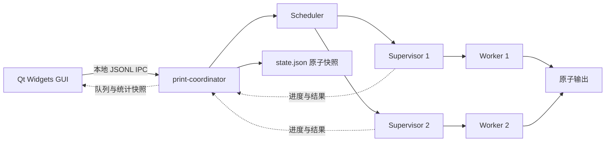

# 架构与操作系统原理

v0.2 的主要业务为打印店经营与异构设备调度，规则见 [经营设计](shop.md)。故障恢复沿用现有结构，优先级低于报价、分配和经营分析。

Qt 经营/订单/设备界面 → 本地 IPC → coordinator → 同一 Scheduler 的设备匹配与库存预留 → 多个执行进程 → 完成结算与经营统计。商业状态与任务状态一起原子持久化；实验工具调用同一匹配函数，按事件时间比较固定营业窗口。

## 当前统一执行结构

GUI 仅持有快照，提交、批量导入、策略切换、暂停、取消全部交给 coordinator。
首次使用时自动启动独立后台；关窗只断开连接，重开同一数据目录后获取持久队列。后台异常退出时客户端尝试重启并重新同步。

`print-coordinator` 持有 Scheduler、策略和可配置能力和速度的打印机（旧目录保留同构槽位）。每次 `claim()` 后先用 `QSaveFile` 原子写入完整 `state.json`，持久化 Running 与 attempt，再启动 supervisor。状态目录用 `.coordinator.lock` 保证单实例。

服务重启时先 `restore()` 快照。对旧 Running/Cancelling 任务，先检查最终输出以及 supervisor/output 两把锁；输出已经提交则完成任务，两把锁均释放且连续确认执行已停止后才调用 `retry()` 或 `acknowledgeCancel()`。取消意图使用 attempt 唯一的 marker 文件，防止取消过程中 coordinator 崩溃后丢失意图。

POSIX 可使用 `print-coordinator --daemon` 脱离终端；Windows 明确使用前台协调进程，不伪装成传统 daemon。

## IPC 与状态边界

Qt LocalSocket / LocalServer 适配 Unix 域套接字与 Windows named pipe，不开放远程 TCP 端口。
队列、策略、暂停状态、等待预览和统计都以后台为准。窗口只发命令，永远不直接改写 `state.json`。
完整协议和报表字段见 [interfaces.md](interfaces.md)，集成验证见 [validation-integration.md](validation-integration.md)。

## OS 内容如何体现在项目中

| 原理 | 当前基础 | 待完成与可答辩实验 |
| --- | --- | --- |
| 调度 | 非抢占 FCFS/SJF/优先级老化 | 同负载比较公平性与等待 |
| 线程同步 | std::mutex 保护入队、领取和结束 | 生产者消费者压力测试；避免持锁做 I/O |
| 多进程 | coordinator / supervisor / worker 为真实进程 | GUI 重开、后台崩溃与取消恢复 |
| IPC | worker 管道 JSONL + coordinator 本地双向 JSONL | 已接入客户端重连与完整快照 |
| 守护 | supervisor 与 coordinator 支持 POSIX double-fork | Windows 保持前台协调，答辩说明平台差异 |
| 文件 I/O | Job JSON、日志、最终输出、原子 state.json | 扩展异常场景实验与结果记录 |
| 文件互斥 | QLockFile | 多实例争用、进程崩溃遗留锁 |
| 原子更新 | QSaveFile | 进程中途被杀时无半份最终结果 |

## 跨平台边界

纯核心库不依赖 Qt，所有 OS 特殊逻辑进入 `src/platform/`。Windows 原生能运行 GUI、worker、监督和测试，**不把 Windows 前台监督进程冒称 POSIX daemon**。课程要求传统 daemon 时用 Linux / WSL2 或 macOS 的独立模式演示。

数据路径通过 QStandardPaths 获得，路径拼接用 QDir。程序用 QProcess 参数数组启动子进程。使用程序退出语义而非假定某个 POSIX 信号值在 Windows 存在。

## 可靠性边界

模拟最终输出支持失败后原子替换，因此可以重做同一任务。物理打印是不可撤销的外部副作用，真实设备接入需要额外的任务查询/人工确认设计。

worker 输入 JSON 仍只包含执行所需字段，不能用于恢复完整 Scheduler。完整快照由 coordinator 的 `state.json` 单独保存；GUI 已从同一持久快照恢复视图；旧版本没有保存的内存历史不能凭空恢复。QSaveFile 提供原子可见性，不在没有文件系统保证时声称电源故障后的严格持久性。

参考课程文件《操作系统原理课程设计》：第 3 页基本内容、第 7–12 页守护进程、第 13–16 页进度与考核。本文按当前用户要求采用三人分工，原始 PDF 不上传仓库。
