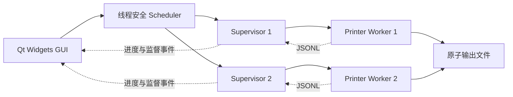

# 架构与操作系统原理

## v0.1 当前可运行结构

GUI 是 v0.1 队列的唯一协调者，最多同时启动两个 supervisor；每个 supervisor 监督一个有限打印任务，worker 退出后按有限次数重启。平台进程 API 通过 QProcess 使用，真实 PID 可见。

GUI 当前只把消息流显示为日志。后续 C 负责按行解析、聚合进度；持久队列和与 GUI 脱离的运行由 B 实现。

## 目标课设结构（待实现部分）

独立协调服务持有持久队列、调度器和打印机槽位；GUI 通过本地 IPC 提交和订阅。服务由独立守护进程监督，关闭 GUI 不影响任务。A 负责状态机与调度接口，B 负责服务生命周期与恢复，C 负责连接状态与交互。

目标服务优先考虑 Qt LocalSocket / LocalServer（Unix 域套接字与 Windows named pipe 由 Qt 适配），协议沿用 versioned JSONL。当前不依赖 TCP 端口，也不开放远程访问。

## OS 内容如何体现在项目中

| 原理 | 当前基础 | 待完成与可答辩实验 |
| --- | --- | --- |
| 调度 | 非抢占 FCFS/SJF | 老化优先级、相同输入下的公平性/等待对比 |
| 线程同步 | std::mutex 保护入队、领取和结束 | 生产者消费者压力测试；避免持锁做 I/O |
| 多进程 | supervisor 和 worker 为真实子进程 | 协调服务独立化、进程树正常清理 |
| IPC | JSONL 标准管道事件流 | 双向控制、分帧、重连 |
| 守护 | POSIX double-fork + 独立监督 | 服务守护、退避、恢复，区别于普通 daemon thread |
| 文件 I/O | Job JSON、日志、最终输出 | 持久任务队列与恢复对账 |
| 文件互斥 | QLockFile | 多实例争用、进程崩溃遗留锁 |
| 原子更新 | QSaveFile | 进程中途被杀时无半份最终结果 |

## 跨平台边界

纯核心库不依赖 Qt，所有 OS 特殊逻辑进入 `src/platform/`。Windows 原生能运行 GUI、worker、监督和测试，**不把 Windows 前台监督进程冒称 POSIX daemon**。课程要求传统 daemon 时用 Linux / WSL2 或 macOS 的独立模式演示。

数据路径通过 QStandardPaths 获得，路径拼接用 QDir。程序用 QProcess 参数数组启动子进程。使用程序退出语义而非假定某个 POSIX 信号值在 Windows 存在。

## 可靠性边界

模拟最终输出支持失败后原子替换，因此可以重做同一任务。物理打印是不可撤销的外部副作用，真实设备接入需要额外的任务查询/人工确认设计。

当前不会从磁盘恢复 GUI 队列；输入 JSON 只包含 worker 所需信息。QSaveFile 提供原子可见性，不在没有文件系统保证时声称电源故障后的严格持久性。

参考课程文件《操作系统原理课程设计》：第 3 页基本内容、第 7–12 页守护进程、第 13–16 页进度与考核。本文按当前用户要求采用三人分工，原始 PDF 不上传仓库。
