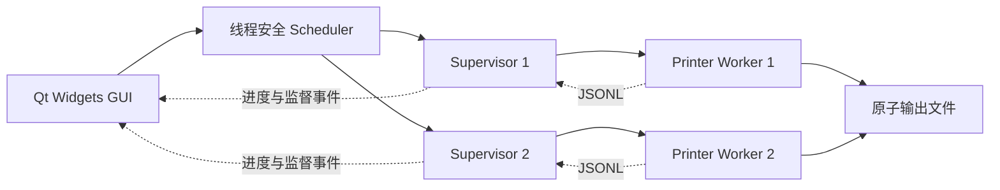
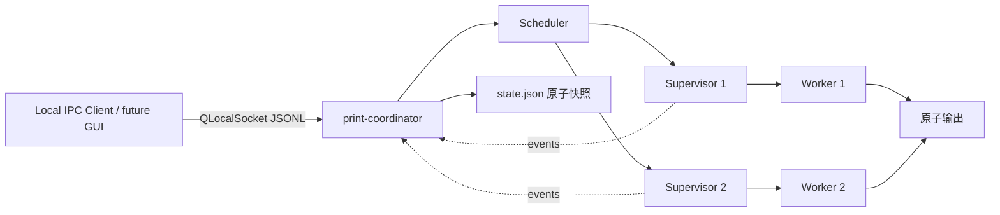

# 架构与操作系统原理

## v0.1 当前可运行结构

GUI 是 v0.1 队列的唯一协调者，最多同时启动两个 supervisor；每个 supervisor 监督一个有限打印任务，worker 退出后按有限次数重启。平台进程 API 通过 QProcess 使用，真实 PID 可见。

GUI 当前只把消息流显示为日志，仍走这条 v0.1 旧链路。C 负责后续将 GUI 改为连接 coordinator、按行解析并聚合进度。

## B 组已实现的持久后台结构

`print-coordinator` 持有 Scheduler、策略和固定打印机槽位。每次 `claim()` 后先用 `QSaveFile` 原子写入完整 `state.json`，持久化 Running 与 attempt，再启动 supervisor。状态目录用 `.coordinator.lock` 保证单实例。

服务重启时先 `restore()` 快照。对旧 Running/Cancelling 任务，先检查最终输出以及 supervisor/output 两把锁；输出已经提交则完成任务，两把锁均释放且连续确认执行已停止后才调用 `retry()` 或 `acknowledgeCancel()`。取消意图使用 attempt 唯一的 marker 文件，防止取消过程中 coordinator 崩溃后丢失意图。

POSIX 可使用 `print-coordinator --daemon` 脱离终端；Windows 明确使用前台协调进程，不伪装成传统 daemon。

## 目标课设结构（仍待 C 集成）

独立协调服务、持久队列、恢复和本地 IPC 已由 B 实现。剩余主链是 C 将 GUI 从旧的内存 Scheduler 切换为本地 IPC 客户端，使关闭 GUI 不再影响后台任务，并补连接状态、重连和结构化进度展示。

服务采用 Qt LocalSocket / LocalServer（Unix 域套接字与 Windows named pipe 由 Qt 适配），协议为 versioned JSONL，不依赖 TCP 端口，也不开放远程访问。

## OS 内容如何体现在项目中

| 原理 | 当前基础 | 待完成与可答辩实验 |
| --- | --- | --- |
| 调度 | 非抢占 FCFS/SJF | 老化优先级、相同输入下的公平性/等待对比 |
| 线程同步 | std::mutex 保护入队、领取和结束 | 生产者消费者压力测试；避免持锁做 I/O |
| 多进程 | coordinator / supervisor / worker 为真实进程 | C 接入后做完整 GUI 断开/重连演示 |
| IPC | worker 管道 JSONL + coordinator 本地双向 JSONL | C 完成客户端重连与状态聚合 |
| 守护 | supervisor 与 coordinator 支持 POSIX double-fork | Windows 保持前台协调，答辩说明平台差异 |
| 文件 I/O | Job JSON、日志、最终输出、原子 state.json | 扩展异常场景实验与结果记录 |
| 文件互斥 | QLockFile | 多实例争用、进程崩溃遗留锁 |
| 原子更新 | QSaveFile | 进程中途被杀时无半份最终结果 |

## 跨平台边界

纯核心库不依赖 Qt，所有 OS 特殊逻辑进入 `src/platform/`。Windows 原生能运行 GUI、worker、监督和测试，**不把 Windows 前台监督进程冒称 POSIX daemon**。课程要求传统 daemon 时用 Linux / WSL2 或 macOS 的独立模式演示。

数据路径通过 QStandardPaths 获得，路径拼接用 QDir。程序用 QProcess 参数数组启动子进程。使用程序退出语义而非假定某个 POSIX 信号值在 Windows 存在。

## 可靠性边界

模拟最终输出支持失败后原子替换，因此可以重做同一任务。物理打印是不可撤销的外部副作用，真实设备接入需要额外的任务查询/人工确认设计。

worker 输入 JSON 仍只包含执行所需字段，不能用于恢复完整 Scheduler。完整快照由 coordinator 的 `state.json` 单独保存；当前 GUI 尚未接 coordinator，因此 GUI 自己的旧内存队列仍不会恢复。QSaveFile 提供原子可见性，不在没有文件系统保证时声称电源故障后的严格持久性。

参考课程文件《操作系统原理课程设计》：第 3 页基本内容、第 7–12 页守护进程、第 13–16 页进度与考核。本文按当前用户要求采用三人分工，原始 PDF 不上传仓库。
