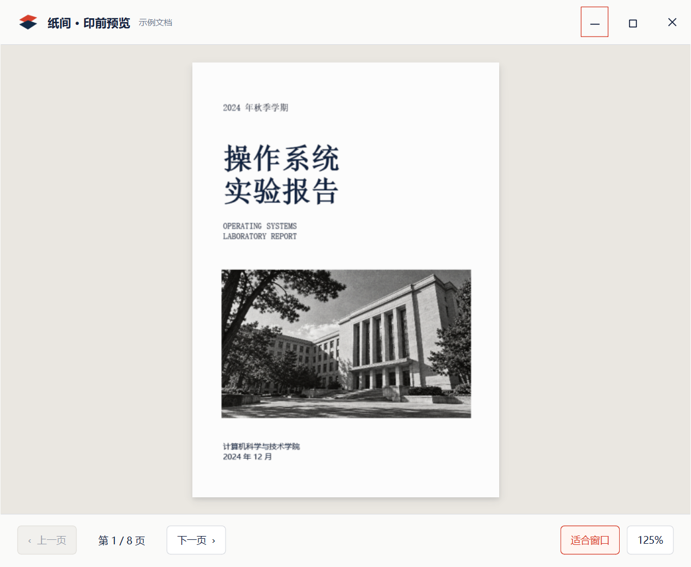
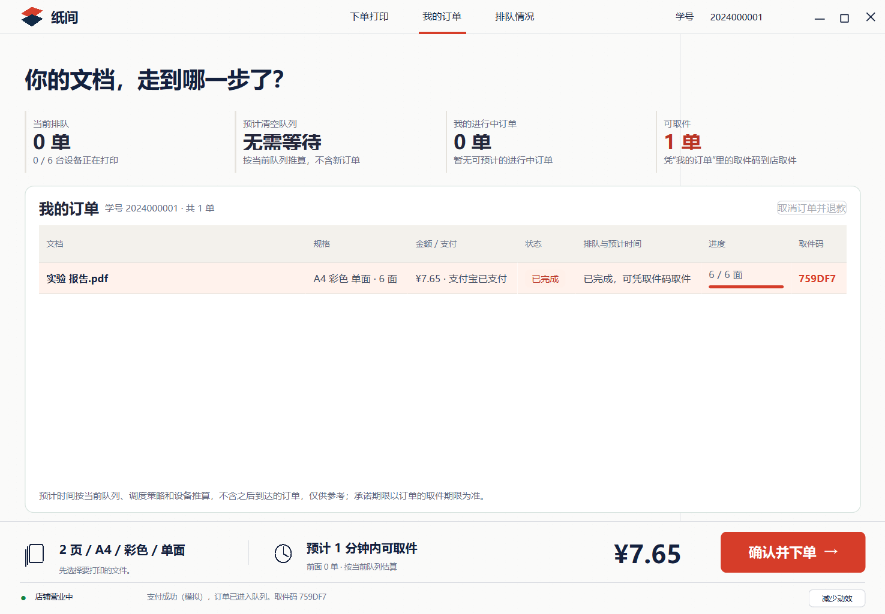
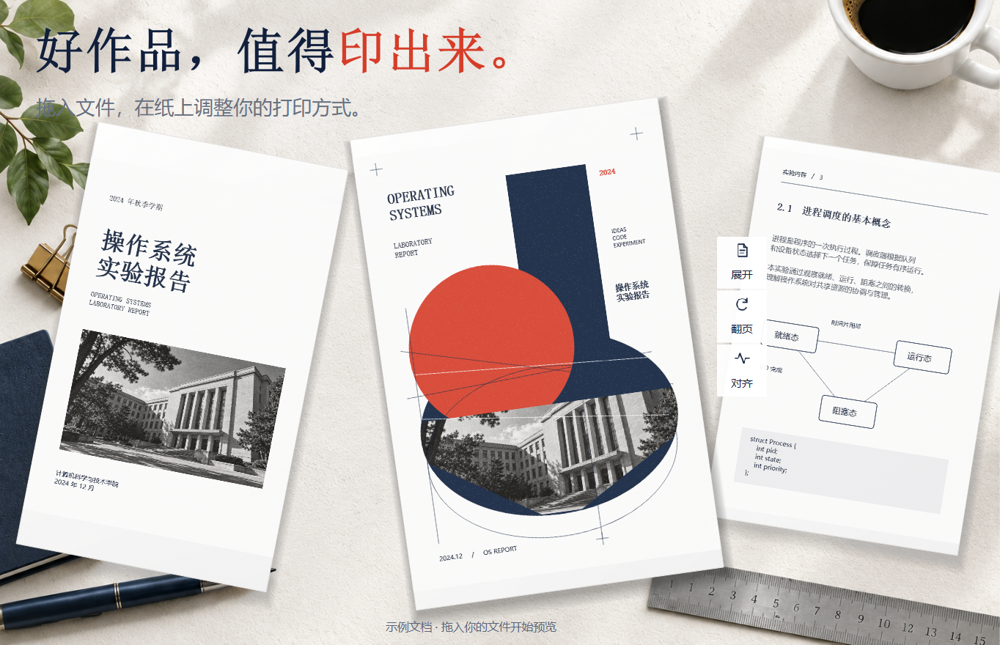
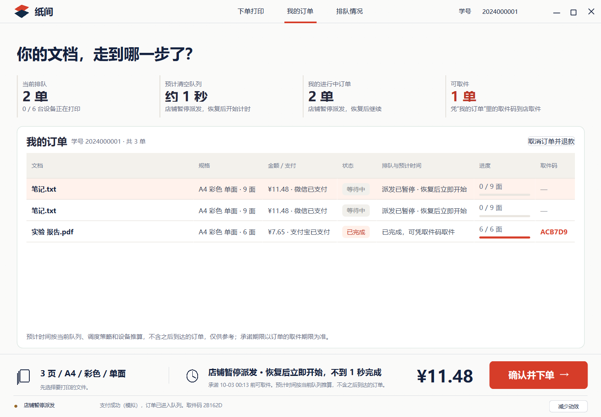
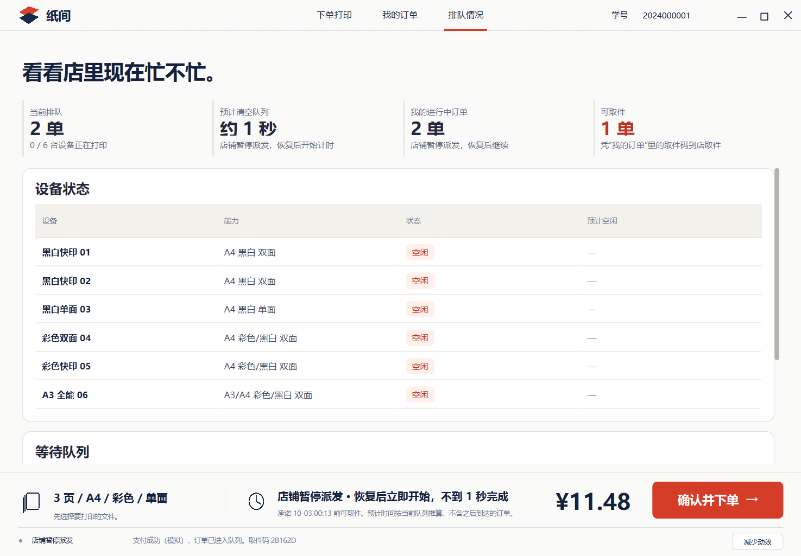

# 纸间第二版：俯视印刷编辑台

## 分支提交前复核（2026-10-09）

本分支 `feat/print-editorial` 的 README 开头新增三页功能表、学生启动方式，以及摘要文字适配和 Windows 外框阴影的修复说明；明确本地原件、模拟支付与共享后台的数据目录边界。

本机 Release 构建及完整 CTest 13/13 通过，Windows 原生窗口外框、文档阅读器、下单/支付/订单与排队摘要检查全部通过（含初始化/清理为 5 passed）。摘要检查覆盖三种窗口尺寸及空队列、暂停派发、可取件状态，本机 DPR 为 1.25。日志为 `runtime/student-final-ctest.txt` 和 `runtime/student-final-native.txt`。现有 `editorial-v13` 运行版本保留；本轮补充说明并修正测试的后台就绪等待，不变更运行程序行为。

远端 Windows 的预测回归曾在后台连接尚未就绪时直接发出暂停请求，慢启动时请求会被正确拒绝，随后订单开始打印。测试现先等待实际暂停控件可用，再等待后台暂停状态显示，之后才提交三个预测任务；保留全部原有预测时间与恢复派发断言。本机修正后的完整 CTest 13/13 通过。远端平台结果以最终提交对应的 Actions 为准。

## v13 原生窗口轮廓和阴影（2026-10-08）

与店主端共用窗口框架，Windows DWM 绘制低对比度浅灰轮廓、圆角和柔和外部阴影；失焦时轮廓淡化，最大化时取消扩展边距并继续按工作区避开任务栏。自绘顶部导航及原窗口操作保留。Windows 11 圆角/边色提示在旧版本系统上由 DWM 忽略。

原生窗口、文档预览和订单/排队指标回归共 5 passed / 0 failed（含初始化/清理），日志为 `runtime/student-v13-native-tests.txt`。原生外框验收读取 DWM 属性，并在自建纯色背景上捕获实际合成画面、检查底部阴影像素；截图在 `runtime/student-v13-frame/student-native-frame.png`。完整 Release CTest 与独立发布包验收日志分别为 `runtime/native-frame-ctest.txt`、`runtime/student-v13-package-verification.txt`。独立包 `editorial-v13` 沿用 `runtime/editorial-shop`，学生原图标、旧包和所有概念图保留。

## v12 指标卡文字完整性修复（2026-10-08）

“我的订单”和“排队情况”共用的指标卡跟随外层画布缩放，但原来三行文字仍保留固定字号和默认布局间距，导致“无需等待”等大字被压缩裁切。指标卡现在局部同步字号、边距与间距，保留原字体家族、字重、配色和文案。

原生 `studentOrderPaymentAndForecast` 在 DPR 1.25 / 1.6 下通过，并在 920×640、1180×820、1420×888 三种窗口尺寸检查两页所有相关可见标签的实际字体宽度/行高与文字框，覆盖空队列、暂停与可取件状态。日志为 `runtime/student-text-{125,160}.txt`，截图在同名目录。发布版本为独立 `editorial-v12`，旧包和现有店铺数据保留。

独立分支 `feat/print-editorial`，工作树 `campus-print-editorial`。以已经确认的白红墨蓝效果图为依据：顶部导航、三张倾斜纸张、右侧设置、固定底部结算。保留原经营模式的报价、学生订单、模拟支付、取消退款、设备与排队信息。

代理接手、部署命令、配置和完成条件以 [student-handoff.md](student-handoff.md) 为入口。本文件保留设计迭代与已执行的本机证据。正式发布使用 Release preset；此前 v3–v8 本机发布包来自 `dev` Debug 构建。

## 运行

Windows 双击桌面的“纸间打印”快捷方式或仓库根目录 `start-editorial.vbs`，只显示 UI，不打开命令行窗口。优先运行 `dist/editorial-v13` 的 Release 发布包，兼容旧的 v12/v11/v10/v9/v8/v7/v6/v5/v4/v3/v2，否则运行 `build/dev/bin`；构建版本需要匹配的 Qt 在 PATH 中。`start-editorial.cmd` 保留用于命令行兼容。独立发布包也提供 `start-student.vbs`，其数据使用默认用户目录。启动参数为 `--role student`，数据独立存放在本工作树的 `runtime/editorial-shop`，不共用第一版的数据目录。

空白状态展示明确标注的示例报告；选择文件后，纸张会显示本机文件内容。可拖入文件或按 Ctrl+O，Ctrl+1/2/3 切换下单、我的订单与排队情况。

也可运行 `wscript start-editorial.vbs --document "C:\文档\实验报告.pdf"`，直接在学生端打开本地文件。


桌面背景和黑白建筑照片直接使用用户提供的两张素材，嵌入 Qt resources。示例封面的墨蓝几何、朱红圆形、建筑拼贴、定位十字、细线和印刷纹理由 QPainter 分别绘制；选择真实文件后改为该文件的页面内容。

## 窗口、支付与预览

- 学生端采用无系统标题栏的窗口：品牌、导航、学号和最小化/最大化/关闭共用一行。拖动顶部空白区域移动窗口，双击可最大化/还原，边缘可调整大小；最大化使用当前显示器的工作区域。
- Windows EXE 使用 GUI 子系统，嵌入红蓝双纸品牌的多尺寸 ICO；运行时窗口也设置同一图标。后台协调器、监护进程、打印进程及策略实验用无可见控制台的方式启动，仍保留日志与 IPC。
- 支付确认全部重排为纸白、朱红、墨蓝：标题与关闭按钮直接放在内容中，不增加额外标题白条。订单总额、文档、规格、费用、取件和支付方式使用同一视觉语言。提交期间不能重复支付或直接关闭，失败可返回修改。
- 印前预览采用统一品牌与窗口控件，暖灰底衬、居中纸张及轻阴影；默认整页适合窗口，底部固定翻页、页码和 125% 放大。方向键/PageUp/PageDown 翻页，Ctrl+0 恢复适合窗口。




## 文档与交互

- PDF：PDFium 读取真实页面及页数，并渲染当前页与相邻页；支持中文和空格路径、扫描 PDF。加密或损坏 PDF 显示明确错误。
- 图片：本地显示图片，遵循图片的方向信息；第一帧作为一页。
- UTF-8 文本、Markdown、代码和 CSV：按原文本内容分页。Markdown 按源文本展示。
- Office 文档：仍可登记文件信息，但不伪造内容预览；预览提示先导出 PDF。经营后端仍只接收订单元数据。
- 悬停纸张：以 120–240ms 连续速度的过渡临时展开，移开自动恢复构图，中途反向保留当前位置和速度；点击展开/收起：保持展开或解除保持；对齐：整理纸张角度和位置。开启减少动效后不自动悬停展开，点击控制立即生效。
- 翻页：双面模式检查另一面；两侧页码箭头按纸张切换，单面模式一张对应一页。双击纸张或点击“放大预览”可逐页查看原文件，支持放大与滚动。
- 奇数末页的背面在桌面和放大阅读器中均显示留白；替换、移除文件或改变预览规格会关闭旧阅读器，避免显示过期页面。
- A4/A3、黑白/彩色、单双面、份数及服务等级会更新预览规格和真实经营报价。减少动效会立即停下并恢复所有纸张动画的最终状态。

文档只在本地 GUI 进程读取，不上传、不写入订单状态。底部报价和取件估计来自现有协调服务；下单打开确认与支付方式选择。支付和打印执行沿用课程项目的模拟后端，不连接物理打印机。

## 构建与验证

```sh
python tools/setup_pdfium.py
cmake --preset dev -DCMAKE_PREFIX_PATH="<Qt installation>"
cmake --build --preset dev --parallel 2
ctest --preset dev
```

`setup_pdfium.py` 将固定版本 `pypdfium2==5.13.0` 及原生 PDFium/许可证安装到本工作树 `.tools/pdfium`，不修改全局 Python 环境。CMake 会把原生库复制到程序旁。也可通过 `CPS_PDFIUM_LIBRARY` 指定已有的原生库；制作发布包仍需提供对应第三方许可证。

文档解析器使用 PDFium 官方 C ABI。PDFium 调用只发生在 GUI 线程，源字节缓冲在文档关闭前始终保持有效；按需缓存 12 页，渲染尺寸限制为 1000×1400，每次只绘制当前和相邻页面。

GUI 测试包含真正的两页 PDF，验证渲染像素、单双面翻页、放大阅读器、对齐、展开、图片与文本内容替换、文件移除、紧凑窗口，以及支付/订单/退款流程。设置 `CPS_GUI_EVIDENCE_DIR` 可保存运行截图和动画帧。证据必须来自 Qt 程序实际绘制，不用设计图替代。

Windows 发布包：

```sh
python tools/package_app.py --bin-dir build/ci/bin --qt-bin "<Qt installation>/bin" --output-dir dist/editorial-v10
python tests/package_smoke.py --package-dir dist/editorial-v10
```

程序嵌入用户提供的桌面材质和校园建筑图片；所有控件、纸张和排版由程序绘制。发布包带 PDFium 原生库和第三方许可证。其他系统需独立验证，不能由本机 Windows 结果推断。

底部取件文案由后端完成时间向上取整为分钟，悬停查看精确排队信息和服务承诺；服务档位的价格沿用后端定价，不抄概念图的静态数字。920×640 的小窗口也保留设置和结算入口；纸张对齐后不遮挡标题与拖入文件的说明。

2026-10-02 本地验证：Qt 6.10.1 / MinGW 13.1 构建成功，启用警告作为错误；完整 CTest 13/13 通过。Windows 原生窗口的 `editorialDocumentPreview` 和 `studentOrderPaymentAndForecast` 均通过，覆盖真实 PDF/图片/文本、放大、单双面、末张留白、替换文件、报价、支付、订单和取消退款。`dist/editorial-v3` 在移除 SDK 路径后通过独立运行检查，发布程序与本地最终构建的 SHA-256 相同。

2026-10-02 窗口精修验证：最终构建完整 CTest 13/13 通过；Windows 原生测试通过主窗最小化/最大化/还原/关闭、预览最大化/适配/放大/翻页、支付方式和订单/退款、提交中关闭保护。v4 发布包移除 Qt SDK 路径后通过启动、重连与模拟打印检查，检查了 EXE GUI 子系统、图标资源和协调器/监护进程/打印进程均没有可见控制台窗口。

## v5：订单配色与悬停交互

学生端订单、设备与等待队列表格使用专属绘制配色：朱红进度条与取件码、浅暖红选中行、暖灰表头、红色完成/空闲标签及可取件数量。进行中状态以墨蓝区分，等待状态使用暖灰文字；业务状态文案保留。Qt CellDelegate 的主题参数仅在这三张学生端表格开启。

纸张悬停区域遵循实际纸张的旋转和尺寸，进入后覆盖整个展开运动范围，防止边缘位移导致反复开合。使用事件的全局坐标映射到预览区域，覆盖子控件的悬停事件。鼠标滑过纸张上的展开/翻页/对齐按钮时保持展开；点击保持展开后移开不合拢，再次点击解除保持。减少动效停止动画并恢复明确的最终姿态。

支付方式采用本地矢量绘制的微信、支付宝和校园卡识别图标，上图标、下文字；支付品牌保留辨识色，选择边框沿用朱红。






2026-10-02 v5 验证：Qt 6.10.1 / MinGW 构建成功，完整 CTest 13/13 通过；Windows 原生窗口测试验证悬停中间帧、自动复位、快速反向、工具按钮区域、手动保持与解除、减少动效，以及支付/订单/退款和窗口控件。订单截图的真实渲染像素检查覆盖红色进度、取件码、完成标签及暖色选中行；支付测试检查三个图标及支付方式选择。`dist/editorial-v5` 移除 SDK 路径后通过启动、持久队列、模拟打印、窗口图标和后台无可见控制台验证。

## v6：桌面切换与收款码位置

打印设置的竖分隔线仅在下单页绘制，订单和排队页保留完整背景。黑白/彩色合为一个半透明圆角切换条，使用柔和阴影和浅暖色选中底，保留独立键盘焦点与原有报价/预览同步。

支付区增加随方式切换的收款码卡片：微信和支付宝使用各自的图标、标题和图片；校园卡显示刷卡位置。未配置或图片损坏时明确显示占位，不生成可扫描的模拟收款码。图片仅在本地读取，支付仍由模拟后端执行；提交期间锁定支付方式，避免处理中切换造成歧义。小屏幕可以滚动访问完整支付内容。

将实际图片保存到当前 `--data-dir` 的 `payment-codes/wechat.png` 与 `payment-codes/alipay.png`，也支持 `.jpg`（优先读取同名 PNG）。根目录 VBS 启动对应 `runtime/editorial-shop/payment-codes/`；替换图片后重新选择相应支付方式或重新打开支付窗口即可刷新。图片保持完整比例，包括原有二维码留白。此配置仅展示图片，不接入真实到账确认。

v8 支持点击“放大收款码”打开符合主题的无系统标题栏窗口，完整展示收款海报。真实收款码的扫描可能产生真实转账，应用内“确认支付”依旧是模拟流程；两处均明确说明，避免误认为接入了自动到账确认。配置图片位于已被 Git 忽略的运行目录，不嵌入资源、不复制进通用发布包，也不放入文档截图。公开发布代码和通用安装包后，使用者仍需自行配置收款图片。v8 验收时根目录与桌面快捷方式使用 `dist/editorial-v8`；当前入口版本见文首。







2026-10-02 v6 验证：最终构建完整 CTest 13/13 通过，Windows 原生 GUI 的收款码、悬停、窗口、文档与订单支付五个用例全部通过（含初始化/清理为 7 项）。收款码检查覆盖未配置、两个独立图片源、比例保留、校园卡及损坏图片回退。悬停检查通过窗口系统事件路径注入鼠标事件，等待实际动画进度，避免共享桌面光标和固定截图等待时间引入波动。`dist/editorial-v6` 在移除 SDK 路径后通过持久队列、模拟打印、应用图标和后台无可见控制台检查。

## v7：悬停动画性能

桌面添加“纸间打印”快捷方式，指向稳定的 VBS 启动入口并使用品牌 ICO；后续更新启动脚本即可跟随新版。

纸张阴影从每帧 60 层旋转覆盖绘制改为预制图层；桌面按窗口尺寸和设备像素比缓存，纸张内容、材质和黑白转换合成到受 32 MiB 上限约束的缓存中。替换文件、页数、纸张规格、颜色或示例/真实文档切换时失效，翻页按页面键选择图层。动画中只变换已有图层，不重复渲染 PDF 或转换整页颜色；预览区域声明不透明，避免重绘其后方的桌面父容器。放大阅读器继续使用原始页面。

开合采用 120–240ms 的 Hermite 过渡，完整行程 240ms；中途改方向时继承当前位移和速度，端点静止，位置限制在原构图范围内。手动保持展开、子按钮悬停、减少动效行为保留。

本机 Qt 6.10.1 / Windows / 125% 缩放下，单帧绘制中位从优化前约 56ms 降到最终约 3.5ms，p95 从约 62ms 降到约 4.5ms。完整窗口的示例与黑白 PDF 开合帧间隔 p95 均约 17ms。测量窗口为 1218×788 逻辑像素，完整窗口为 1420×820；计时排除 PNG 编码，动画运行于实际事件循环。日志保留于 `runtime/editorial-v7-baseline.txt`、`editorial-v7-round1.txt`、`editorial-v7-native.txt`。

`editorialAnimationFrameBudget` 测量纸张绘制及完整应用中的示例/黑白 PDF 帧间隔。通过 `CPS_GUI_VERIFY_FRAME_BUDGET=1` 显式启用本机验收阈值（绘制 p95 < 16.7ms，帧间隔 p95 < 27ms）；常规跨平台测试保留功能检查和计时输出，不假定 CI 机器性能。`editorialMotionRetargeting` 验证反向时位置/速度连续和端点边界。

2026-10-02 v7 最终验收：完整 CTest 13/13，通过带帧预算阈值的 Windows 原生 GUI 检查 9/9（含初始化/清理）；`dist/editorial-v7` 移除 SDK 路径后通过独立启动、持久队列、模拟打印、品牌图标及后台无可见控制台检查，发布 EXE 的 SHA-256 与最终构建一致。

2026-10-02 v8 验证：完整 CTest 13/13 通过；Windows 原生收款码、窗口与支付流程测试通过。实际两张本地 JPEG 均成功读取并在放大窗口显示；截图只保留于被忽略的 runtime 目录。独立发布包通过持久队列、模拟打印、应用图标及后台无可见控制台检查，文件哈希审计确认没有打包真实收款图片。此项验证时尚未执行 GitHub 推送。

## v9：Release 与代理交接

`AGENTS.md` 提供按任务读取的入口，`student-handoff.md` 记录模块、行为边界、部署命令、配置与可检查的完成条件。发布脚本随包附带交接、设计证据、接口与分工文档；设计截图的相对链接在包内可读取。

2026-10-02 本机 `ci` Release / Qt 6.10.1 / MinGW 13.1 完整 CTest 13/13、带帧预算门槛的原生 GUI 9/9 通过；绘制 p95 4.44ms，完整窗口示例/黑白 PDF 帧间隔 p95 17.13/17.08ms。进程测试清理仅对本次临时目录的 Windows 日志共享占用等待，最多 5 秒，其他错误保持失败；该测试连续三轮及最终完整套件通过。远端 CI 结果以对应提交的 Actions 为准。

v10 修正文档阅读器在 macOS 的窗口 flags：在非阻塞 open 前明确设置 WindowModal，避免 Qt 默认转成 Sheet 时丢失 FramelessWindowHint。回归继续检查无系统标题栏，并同时检查模态类型；原生 Windows 行为保持。跨平台检查结果以 Actions 对应最终提交为准。
