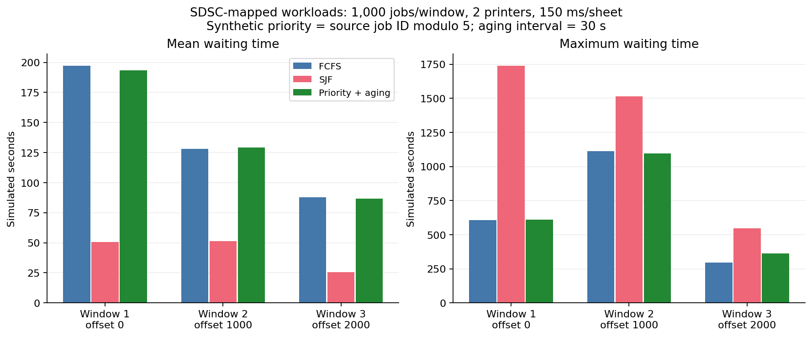
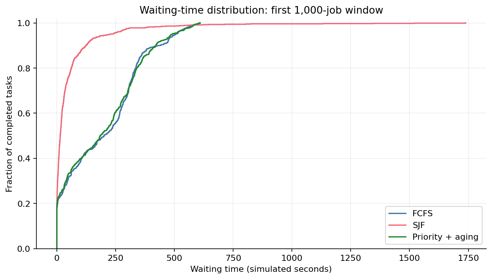
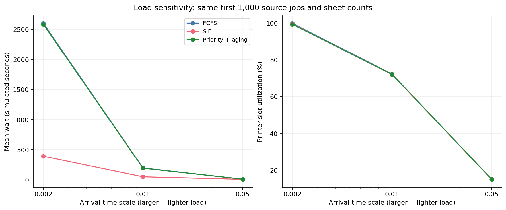
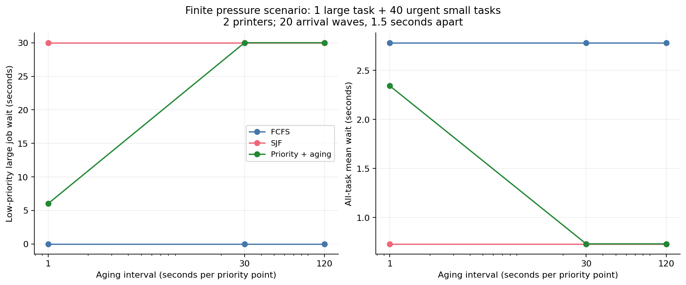

# A：调度策略实验报告

本次固定负载回放中，SJF 在三个窗口均降低平均等待和 p95，但最长等待均高于 FCFS。优先级老化体现的是紧急程度与等待公平性的取舍；在自建压力场景中，将老化周期由 30 秒缩短到 1 秒，使低优先级大任务的等待从 30 秒降到 6 秒，同时提高了整体平均等待。这些结果支持按目标选择策略，不能据此认定一种策略在所有场景都最好。

实验执行日期：2026-09-23（北京时间）。程序、配置和实验脚本版本：[`43209c1`](https://github.com/We1chan/campus-print-scheduler/commit/43209c1c241a888c031458cad85cef855b0e569a)，执行时受 Git 跟踪的文件无未提交修改。使用 macOS 27 arm64、Qt 6.10.2、C++17 Release、Python 3.13.15。数据来自事件模拟，表中时间均为**模拟秒**，不是程序运行耗时或真实打印计时。

## 1. 数据与映射

输入为 SDSC/NPACI 历史计算作业的 [WRENCH SWF 镜像](https://raw.githubusercontent.com/wrench-project/task_clustering_batch_datasets/master/workloads/sdsc_sp2.swf)，字段含义按 [SWF 规范](https://www.cs.huji.ac.il/labs/parallel/workload/swf.html)解释。原始日志介绍、提供者及使用条件见 [Parallel Workloads Archive](https://www.cs.huji.ac.il/labs/parallel/workload/l_sdsc_sp2/)。本实验使用下述哈希锁定的镜像版本，不把它称为官方最新清洗版。

源文件 SHA-256：`2bb635f4b5793f52bd49ccb8fd913d95f9c5be6346925162cadcaf0117e28cf2`。

源文件有 59,715 条非注释记录，每条 18 列。转换器保留 43,117 条有效完成记录；跳过 10,917 条非正常完成记录和 5,681 条必要字段不合法记录。保留原文件头、原 job_id、行号及转换参数，以便回溯。

| 规则 | 固定设置 |
| --- | --- |
| 取样 | 有效记录按提交时间稳定排序，offset 为 0 / 1000 / 2000，各取 1000 条，无随机采样 |
| 到达时间 | `(原提交秒数 − 窗口首条提交秒数) × 1000 × time_scale`，四舍五入为毫秒 |
| 页数 | `ceil(原运行秒数 / 60)`，截到 1～1000 页；份数为 1 |
| 打印资源 | 2 台同速设备，150 ms/页，非抢占 |
| 默认到达缩放 | `time_scale=0.01` |
| 优先级 | 对照组全为 0；实验组为原 job_id 对 5 取模，数值越大越优先 |
| 老化 | 默认等待累计每 30 秒增加一级优先级 |

三个窗口的首尾原 job_id 分别是 12～1332、1335～2641、2643～4077；它们是时间排序后的边界，不代表编号连续。对应窗口中有 11 / 2 / 13 条任务被截到 1000 页上限。

原运行时长是计算作业的耗时，页数和优先级是人为映射。未使用原等待时间、处理器数量决定新调度，也没有引入个人文档。status 筛选、时间压缩和页数截断都会改变分布，因此本实验用于算法比较，不能估计真实校园打印需求。

## 2. 方法与指标

共 11 个场景、每场景 3 种策略，得到 **33 组策略结果**：三个窗口 × 两种优先级映射 = 6 个场景，另加 2 个到达密度场景、3 个老化周期场景。每场景完整执行两遍，共 66 次策略模拟；两遍 JSON 报告逐字节相同。重复只验证确定性，不作为新的统计样本。

同一时刻先完成已有任务，再提交到达任务，最后按设备编号派发。只有已到达且等待中的任务参与选择。FCFS 按本轮入队时间；SJF 按总页数；PriorityAging 按基础优先级加累计等待老化分数。策略主键相同先比较入队时间，再保持提交顺序。当前实现扫描队列选择任务，单次选择为 O(n)。

每个任务的首次等待 = 首次开始 − 提交，周转 = 完成 − 提交。此次无重试，累计排队等待等于首次等待；各场景所有任务都成功完成，因此平均值分母是该场景的全部任务数。p95 为等待时间排序后第 `ceil(0.95×n)` 项；最长等待为最大值。窗口长度取最早到达到最后完成，吞吐量 = 完成任务数 / 窗口秒数，利用率 = 所有设备忙碌时间之和 /（2 × 窗口长度）。完整窗口/重试统计口径见 [接口文档](interfaces.md)。

实验脚本独立检查逐条派发记录：任务身份唯一、未提前执行、同设备无重叠、服务时间等于页数乘单页耗时，并重新计算等待、周转、吞吐量、利用率。全零优先级组还验证 PriorityAging 与 FCFS 的派发记录一致。

## 3. 三个数据窗口

下表为合成优先级组，数值保留三位小数；完整精度见 [summary.json](../experiments/results/2026-09-23/summary.json)。

| offset | 策略 | 平均等待/s | p95/s | 最长等待/s | 平均周转/s | 利用率/% |
| --- | --- | ---: | ---: | ---: | ---: | ---: |
| 0 | FCFS | 197.199 | 504.480 | 605.530 | 212.822 | 72.305 |
| 0 | SJF | 50.635 | 228.180 | 1738.980 | 66.258 | 72.079 |
| 0 | PriorityAging | 193.378 | 490.690 | 610.130 | 209.001 | 72.185 |
| 1000 | FCFS | 128.033 | 424.840 | 1113.240 | 146.385 | 69.416 |
| 1000 | SJF | 51.323 | 237.390 | 1514.640 | 69.675 | 69.468 |
| 1000 | PriorityAging | 129.303 | 456.350 | 1097.270 | 147.654 | 69.323 |
| 2000 | FCFS | 87.873 | 243.890 | 295.930 | 102.278 | 59.867 |
| 2000 | SJF | 25.477 | 117.210 | 546.210 | 39.881 | 59.867 |
| 2000 | PriorityAging | 86.696 | 260.870 | 361.210 | 101.101 | 59.867 |



SJF 优先完成短任务，第一窗口平均等待由 197.199 秒降到 50.635 秒，但最长等待由 605.530 秒升到 1738.980 秒。其余两窗也呈现相同方向的取舍。PriorityAging 在这些合成优先级下与 FCFS 接近，第二窗口的平均等待还略高，不能把“有优先级”写成“平均等待必然更短”。全零优先级对照组中 PriorityAging 与 FCFS 完全一致，符合两者在该无重试负载下的排序规则。



等待分布图同时保留尾部：多数任务的改善和少数任务的延迟可以同时发生。不能仅凭平均值评价公平性。

## 4. 到达密度敏感性

固定第一窗口的任务页数和合成优先级，仅改变到达时间缩放。缩放越小，任务越集中。

| time_scale | FCFS 平均等待/s | SJF 平均等待/s | PriorityAging 平均等待/s | FCFS 利用率/% |
| --- | ---: | ---: | ---: | ---: |
| 0.002 | 2599.423 | 392.863 | 2582.873 | 99.878 |
| 0.01 | 197.199 | 50.635 | 193.378 | 72.305 |
| 0.05 | 11.253 | 8.845 | 11.226 | 15.065 |



到达集中时设备几乎持续忙碌，队列积压明显；到达分散时等待短，但设备有更多空闲。`0.002` 场景中 SJF 的最长等待为 7002.408 秒，高于 FCFS 的 5647.272 秒，再次说明平均等待和尾部等待是不同目标。同一场景各策略工作量相同，但最后完成时刻和尾部空闲可以不同，所以利用率不必完全相同。

## 5. 老化压力场景

构造一个 40 页、优先级 0 的大任务在 0 时刻入队；另外 40 个 10 页、优先级 5 的任务分 20 波到达，每波两个，间隔 1.5 秒。打印资源仍为两台、150 ms/页。它是有限的可解释场景，不是历史 SDSC 数据。

| 策略 / 老化周期 | 低优先级大任务等待/s | 全体平均等待/s | p95/s | 最长等待/s |
| --- | ---: | ---: | ---: | ---: |
| FCFS（老化参数不参与） | 0 | 2.780 | 3 | 3 |
| SJF（老化参数不参与） | 30 | 0.732 | 0 | 30 |
| PriorityAging / 1 秒 | 6 | 2.341 | 3 | 6 |
| PriorityAging / 30 秒 | 30 | 0.732 | 0 | 30 |
| PriorityAging / 120 秒 | 30 | 0.732 | 0 | 30 |



1 秒老化让大任务在 6 秒时获得执行机会，代价是部分后到紧急任务等待。默认 30 秒老化在这段有限紧急任务流中来不及显著抬高它的排序，因此与 120 秒结果相同。**不能声称默认参数已经在所有负载下消除饥饿**；有限队列全部完成，也不能证明无限持续到达时的性质。

SJF 的 p95 为 0，但大任务等待 30 秒：它只占 1/41，低于 5%。因此 p95 也可能掩盖少数任务，答辩时应同时展示最长等待和指定低优先级任务的等待。

## 6. 复现与证据

按照 [实验运行说明](../experiments/README.md)准备 Qt 和源日志，在项目根目录执行：

```sh
cmake --build --preset ci --parallel 2
python3 tools/run_experiments.py --replay build/ci/bin/scheduler-replay --swf runtime/data/sdsc_sp2.swf --output runtime/a-experiments-reproduced
```

首次构建须先按 [开发文档](development.md)配置 `cmake --preset ci` 和本机 Qt 路径。Windows 使用 `python`，程序路径末尾加 `.exe`；输出目录必须尚不存在。绘图方法见实验运行说明，本轮准确 Python 包版本保存在 [plotting-environment.txt](../experiments/results/2026-09-23/plotting-environment.txt)。

仓库保存 [摘要与证据清单](../experiments/results/2026-09-23/manifest.json)、上述四张 PNG 和同名可编辑 SVG。完整转换输入、逐任务报告、重复运行报告及原始执行 manifest 留在本次机器的 `runtime/a-experiments-2026-09-23/`，该目录被 Git 忽略；其他成员需按配置重新生成。

发布版 manifest 保留配置、来源/输入/报告哈希和源码版本，只把命令中的机器绝对路径改成项目相对路径。重新转换会改变来源元数据的转换日期，跨平台编译会改变二进制哈希；复现时比较去除转换/下载日期后的 `workload_content_sha256`、派发记录与统计数值，不能要求不同平台所有产物字节完全一致。

本次没有真实打印、进程故障、换纸时间、启动耗时或不同设备速度，也没有对三段相关历史记录计算显著性。下一步团队联调应另外验证 GUI、持久后台与实际工作进程的完整链路。

## 来源致谢

SDSC 作业日志由 Victor Hazlewood 提供。Copyright 2000 The Regents of the University of California. All Rights Reserved. 原始权利声明保留在转换负载的 source 元数据中；本报告按教育用途进行模拟分析，来源数据不随项目软件取得新的许可。
