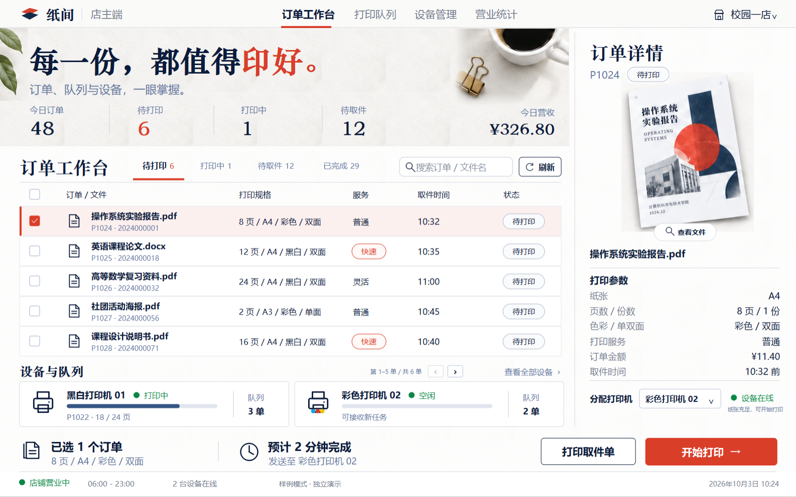
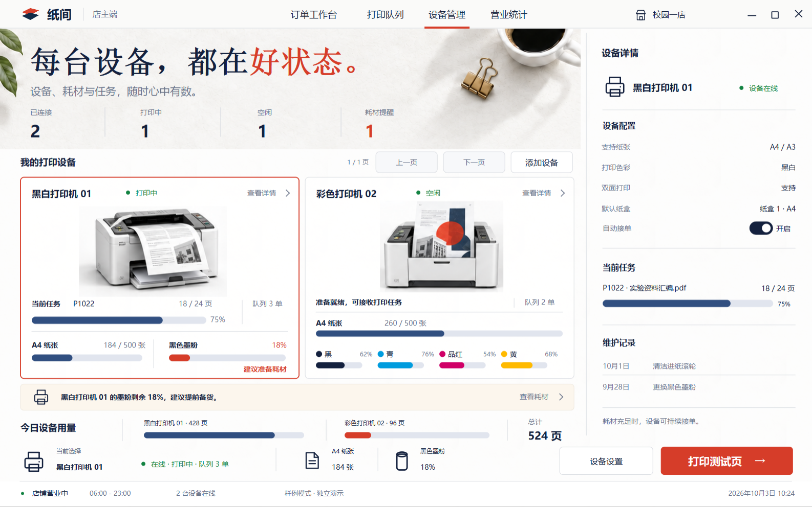
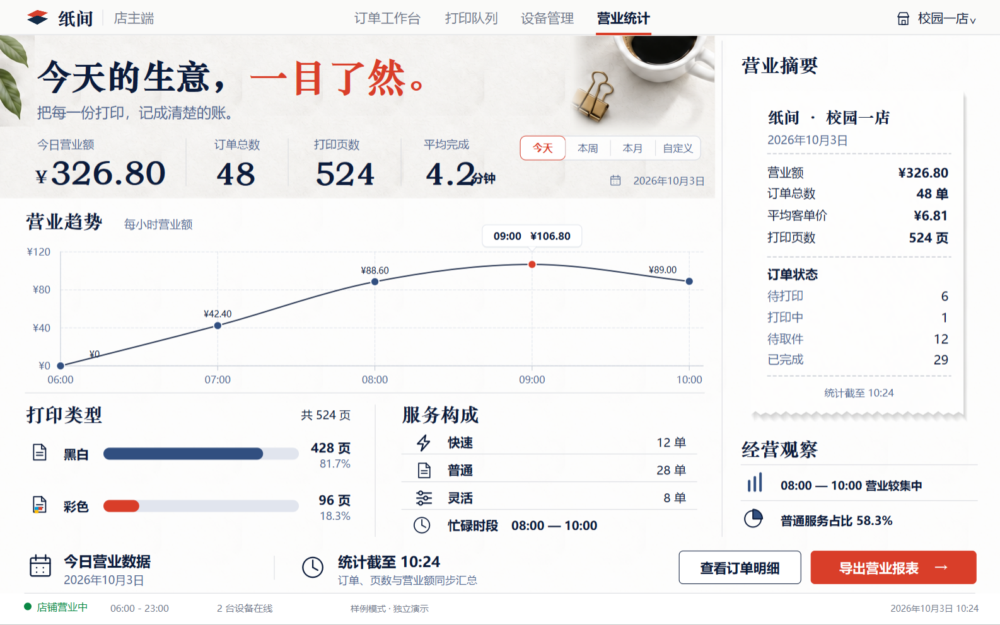
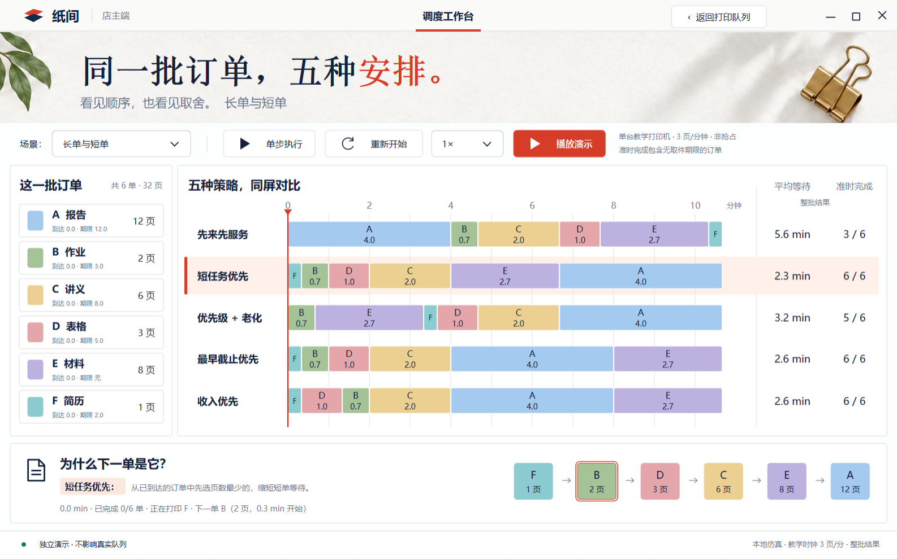

# 纸间店主端

店主端已合并到 `main`。学生端统一为网页，原 Qt 学生窗口和专属预览代码已移除；老板端仍使用共用窗口与对话框控件。

## 打开

Windows 发布包中双击 `preview-merchant.vbs` 查看与概念图对应的交互样例；双击 `start-merchant.vbs` 连接真实持久队列。学生通过网页进入，网关 `--state-dir` 指向老板端同一目录即可共享队列；Windows 可用 `start-classroom-demo.ps1` 同时启动老板端和网页。样例完全独立，不读取或写入真实队列。

本机桌面的“纸间 · 店主工作台”通过源码根目录 `start-merchant.vbs` 启动最新的 `merchant-v13` 发布包，兼容已有旧版本。新版沿用 v3 的专用 `campus-print-merchant.exe` 和加大门店角标的图标；`campus-print.exe` 也只提供老板端。已运行过 v1 时继续使用其 `runtime/shop` 队列；全新安装使用本工作树的 `runtime/merchant-shop`。两个数据目录均需要保留。网页品牌 PNG 和旧店主图标保留，新版图标另存于 `assets/merchant/icons-v3/`，发布包另带同一图案的 `paperroom-merchant-v3.ico` 与用于刷新任务栏缓存的 `paperroom-merchant-v4.ico`。

源码构建后的等价命令：

```powershell
build/ci/bin/campus-print-merchant.exe --merchant-showcase
build/ci/bin/campus-print-merchant.exe --data-dir runtime/shop
python tools/classroom_web.py --coordinator build/ci/bin/print-coordinator.exe --state-dir runtime/shop --open-browser
```

开发启动须配置对应 Qt/MinGW DLL 的 PATH，发布包已包含运行库。旧老板控制台使用 `--classic-owner`；原有 legacy、demo-workload 入口仍保留。

## 页面和交互

四个顶栏页面分别为订单工作台、打印队列、设备管理、营业统计。所有导航项保持学生端相同的深色与常规字重，仅以红色下划线标识当前页。`Ctrl+1…4` 切换，`Ctrl+F` 搜索，`Ctrl+R` 刷新。右上角最小化、最大化/还原、关闭按钮与学生端共用窗口控件。店铺菜单沿用纸白、墨蓝和淡红配色，提供后台刷新，以及真实模式的自动调度策略和全局暂停派发。

按钮交互沿用学生端：普通按钮以平面填色和边色提示悬停/焦点，主要操作使用红色；导航、设备图片和文字入口不再覆盖悬停阴影。键盘仍可聚焦并激活。设备卡外沿的选中态仍表示当前设备。单色设备耗材值距竖线保留 16px，避免“未配置”与竖线重叠。

字体分工与学生端统一：品牌为 24px 粗体微软雅黑，导航为 18px 常规微软雅黑，栏目和数据采用微软雅黑并用字重区分层级；60px 宋体仅用于页面大标语，文档封面也采用宋体。原生菜单与对话框继承 Microsoft YaHei UI。四页标语的红字按前半句真实字宽接续，数字和单位按实际字体宽度排布。

Windows 店主窗口使用独立 `Paperroom.Merchant` 身份和新版窗口图标。任务栏重新启动信息保留店铺数据目录，店主专用 EXE 内嵌新图标；共用窗口控件初始化后重新设置店主图标，避免被学生品牌覆盖。该机制遵循 [Microsoft AppUserModelID 说明](https://learn.microsoft.com/en-us/windows/win32/shell/appids) 和 [任务栏图标属性](https://learn.microsoft.com/en-us/windows/win32/properties/props-system-appusermodel-relaunchiconresource)。

工作台可按状态筛选、搜索文件名/订单号/学号、分页、选择订单和查看详情。右键订单可以取消等待任务；样例打印完成后可确认取件。队列按设备显示进度与顺序，较长队列可翻页。设备页的“上一页 / 下一页 / 添加设备”始终显示并保持同尺寸、同基线；首页禁用上一页、末页禁用下一页，不再弹出边界提示。设备页可切换设备组、调整名称和能力、开关接单，打开耗材补纸窗口。统计页可按今日、本周、本月或自定义日期重算并导出 JSON 报表。

订单详情顶部只保留栏目标题，删除冗长订单号并扩大真实封面预览。文件名与状态标签同一行并按中心高度对齐；参数行和设备选择向下展开，充分利用侧栏高度。文件名过长时省略，完整名称可在“查看文件”对话框查看。设备卡片删除“查看详情”和箭头，整张卡片仍可选中；空闲等状态紧跟名称并做字体高度补偿。

营业统计的四个数字列按真实字宽分配空间，分隔线随内容移动，并与日期选择器保持距离。右侧保留小票、纸张阴影和经营观察的版式，选取直接成本、贡献利润、退款金额、待完成金额与履约计数；不罗列支付渠道。直接成本、退款、贡献利润和完成/按时/超时单数采用与后台 `shopMetrics` 相同的完成时间区间口径，贡献利润为扣退款营业额减直接成本；未完成金额及逾期单数采用该统计截止时刻的在途订单口径。样例成本使用既有 `directCost` 模型。

打印队列的右侧“队列详情”展示所选工单的分配设备、实际页数进度、入队/派发/完成流程、打印规格及取件时间，不重复订单页的文件面板。底部启动/暂停队列按钮已删除；需要暂停或恢复派发时仍使用店铺菜单。设备管理删除底部“今日设备用量”和当前选择/耗材汇总，两个等宽设备卡片向下扩大，设备图片保持原始比例；“设备设置”和“打印测试页”移入右侧“设备详情”侧栏。真实模式测试页操作仍遵循已有接口边界。

## 调度工作台：入口与操作

**入口：启动店主端 → 顶栏“打印队列”（Ctrl+2）→ 队列标题同一行的“调度工作台”按钮。** 按钮位于设备分页区左侧。

打印队列页的“调度工作台”打开独立演示页面，真实模式和样例模式都可进入。2026-10-10 按小组决定改为 FCFS、SJF、综合调度三条同屏时间轴，保留六单固定配色、底部顺序解释和纸面大标语；左侧显示订单参数，点击任一订单会在三条时间轴中同步突出该订单。点击策略名称或指标区切换当前策略及解释。四个场景分别展示长短单、取件期限、服务档位与等待老化、营业高峰与收益；可以单步推进、播放/暂停、重新开始，选择 1×/2×/4× 演示速度。返回按钮回到打印队列，保留队列浏览状态。

演示使用现有 `replayShop` 与三种真实派发策略，单台相同能力打印机、同一批订单及共同时间轴。核心 5 秒/页完整映射为教学时钟 3 页/分钟，所有到达、开始、完成、期限、运行历史和统计同步乘四；综合调度的等待分为教学等待时长除以 2 分钟后取平方根，取到 0.1 分。单机图主要展示第一层排序，第二层的异构设备匹配由后台和实验验证，规则见 [两层调度](scheduling.md)。1× 播放将教学时钟加速 20 倍，单步跳到所选策略的下一个派发或完成事件。平均等待为整批订单的真实开始减到达时间；准时完成计入无取件期限的完成单，口径在页面中明确标注。六单实际合计 32 页，已纠正概念图的 30 页。演示仅在内存计算，不向真实后台发调度命令、提交订单或写入队列数据；真实打印在后台继续运行。

样例初始状态与确认的概念图保持一致：48 单，6 单等待，1 单打印中，12 单待取件，29 单完成；营业额 ¥326.80，524 页（黑白 428、彩色 96）。打开样例不会自行推进；样例操作仍在内存更新四页数据，工作台底部“打印取件单”和“开始打印”按钮按本轮界面要求删除。样例吞吐估算为每分钟 9 页，初始队列预测 12 分钟。

## 校园经营仿真（2026-10-18）

调度工作台场景菜单新增「校园经营 · 150 单」「校园经营 · 300 单」「校园高峰 · 600 单」，保留原有四个六单教学场景。经营仿真使用固定种子 `20261018`，生成作业、报告、讲义、表格、彩色材料和 A3 图纸，包含不同页数、份数、服务档位、到达时间和打印规格。订单是合成业务数据；价格和期限直接调用 `quote()`，前四小时持续到达，观察到第八小时闭店。六台设备来自 `defaultFleet(1250)`，具有不同速度和兼容能力，三策略共享完全相同的订单、设备与库存。

三组六设备时间轴直接来自 `replayShop()`，没有在界面复制调度公式。时间轴改为三策略共用的 30 分钟局部窗口，每五个业务分钟向后移动；每台设备只展示当前及后续最多三单，已完成订单自动移出。点击左侧卡片会暂停并定位到当前选中策略下该订单的开始时刻，时间条可选中高亮；底部保留完整起止时间，跨窗口的执行会在窗边裁切。订单列表支持翻页和滚轮。播放时亮色表示已派发订单，淡色表示后续安排；1× 每秒推进四个业务分钟，右侧指标始终是整场八小时的闭店结果，完整 JSON 导出不受局部视图影响。

指标包括平均/P95 观测等待、快速单准时率、完成数、贡献利润、贡献兑现率、利用率和 `shopQuality()` 综合得分。未开打订单的等待观察到闭店，未完成的快速单仍进入准时率分母，闭店后完成的单不计结算。底部同时显示综合调度相对两个基线的改善和代价，不筛掉落后指标。

「导出仿真」原子保存 JSON，包含完整输入、生成器版本、种子、输入 SHA-256、设备与库存、时间窗口、评分口径、三策略订单历史和派发记录。独立审计：

```powershell
python tools/audit_dispatch_simulation.py <导出的JSON报告>
```

源码构建后可以直接打开高峰场景；运行时 PATH 需包含构建使用的 Qt 与 MinGW DLL 目录：

```powershell
build/ci/bin/campus-print-merchant.exe --merchant-showcase --dispatch-scenario 6
```

此模式全部在内存副本回放，不提交订单、不改真实后台策略；不调用实体打印机或真实支付。该固定负载的结果不能外推为真实校园用户的统计结论。设计与实现记录见 `docs/superpowers/specs/2026-10-18-campus-business-simulation-design.md`。

## 已有后台边界

真实模式接入现有 controller/coordinator：接收学生订单、观察打印进度和持久历史、调整设备能力/在线状态、切换自动调度策略、暂停派发、取消等待任务、补充共享库存、导出真实报表。完成时间和队列清空时间读取后台预测，暂停或受阻的未知预测不显示猜测分钟数。统计范围会同步显示对应的标签与日期。后台提供六个固定设备槽位；“添加设备”在真实模式中打开槽位配置。

现有协议没有手动指定设备、手动重排、指定单机测试页、取件登记或每台设备耗材遥测。这些操作只在标明的样例模式演示，真实模式禁用对应控件或显示未知值。停止设备接单不会中断已经开始的任务。真实模式的报表导出使用后台完整历史，界面的统计范围用于本地汇总。

学生提交的 IPC 只含订单元数据。学生网页下单成功后，网关把 PDF / Office 的真实首页 PNG、上传图片或有上限的文本首页摘要原子保存到同一店铺目录的 `order-previews/`，老板端据此显示实际封面；多文件订单采用第一个文件。原件仍保存在 `classroom-web/uploads/`，不进入 coordinator IPC。老板端 `--data-dir` 必须与网页网关 `--state-dir` 一致，缺少预览组件或保存失败不撤销已接受订单。历史订单可在“查看文件”中选择本机 PNG / JPEG 封面图片补充；桌面端不再保留已删除的学生 PDF / Office 引擎。缺少封面时明确显示缺失，演示封面只用于样例模式。真实运行的取消、派发和付款确认仍遵循原项目的模拟边界。

## 视觉验收

资源中的四张已确认概念图是视觉基准，参考坐标 1586×992。照片、纸纹和样例文档封面沿用原图素材；导航、文字、表格、图表、进度和按钮由 Qt 根据数据绘制。实际有原生 QPushButton、QLineEdit 与键盘焦点，不以整页图片充当界面。

以下为 Windows 原生 Qt 渲染截图：








具体测试、包验收记录见 [merchant-validation.md](merchant-validation.md)。

调度工作台实际运行截图：



四页顶部现在共用完整的无文字摄影纸面素材，叶子、咖啡和金色夹子的底纹与自然光影连贯；所有标题和指标仍由 Qt 实时绘制。素材原图、生成提示与坐标记录见 [素材记录](merchant-materials-v10.md)。

## v7 与学生端设计一致性（2026-10-08）

此次核对的是各元素承担的角色与实际呈现，不把“未选中导航”当作“禁用按钮”。全部导航以 18px 常规微软雅黑 UI 和同一深色显示，只用朱红下划线标识当前页；图片和导航不覆盖悬停阴影。普通按钮为 16px 常规字重、白底浅灰细边，主按钮为朱红；禁用操作使用浅色填充与淡色文字，鼠标不显示可点击手势。Windows 窗口按钮、原生外框与 EditorialDialog 框架与学生端共用。

四页文字层级以学生端为基准（下列为 1586×992 参考画布字号）：品牌 24px 粗体；导航 18px 常规；栏目标题 18px、次级栏目 16px，正文 14px、辅助信息 12–13px；底部摘要标题 21px，说明 12px；营业状态 14px 深色文字，圆点缩小并沿用学生端的绿。大标语仍为 60px 宋体；普通指标为 32px，金额主值为 44px，字重和字体角色与学生端区分层级的方式一致。原有独立店主图标保留。

设备页三个 120×41 按钮固定在同一行：“上一页”“下一页”“添加设备”，移除添加文字旁的装饰符号。页面计数持续显示，每页两台设备；首页点击上一页提示“已经是第一页”，末页点击下一页提示“已经是最后一页”，按钮保持位置和可见状态，不循环跳页。提示同时提供可访问描述。

四页最新本机原生截图在 `runtime/merchant-evidence/v7-gallery/`；这是实际 Qt 控件和画布绘制。验收范围和日志见 merchant-validation.md。
