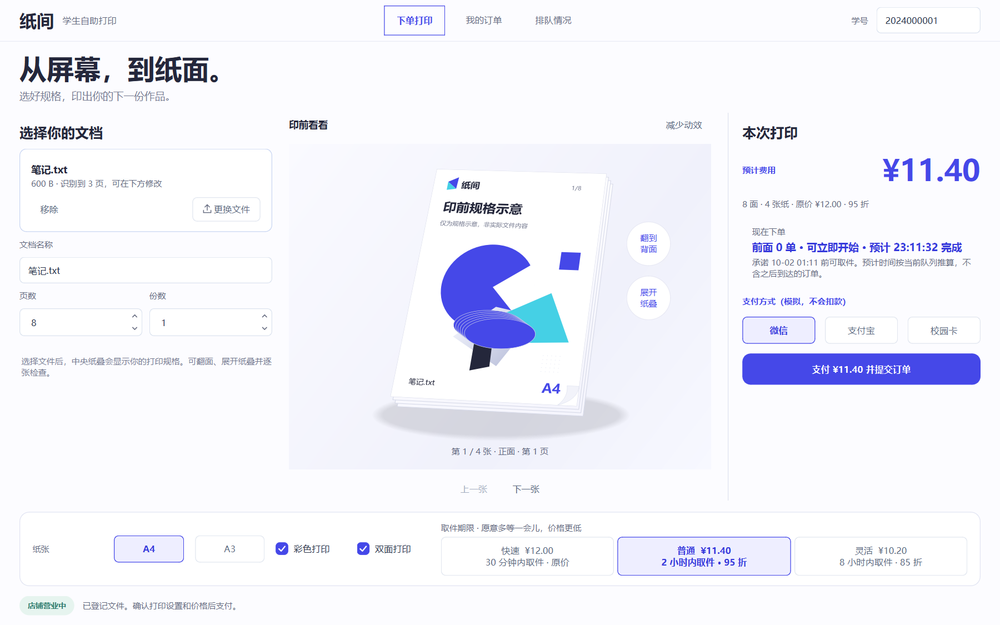

# 纸间：印前桌面

`feat/print-studio` 基于 `9d99635`，以生成的整体构图为视觉参考，实现 Qt 6 原生前端。学生端围绕中央纸叠组织文件信息、报价和打印设置；店主端延用工作台、记录、设备和经营流程，并统一导航与配色。

## 构图与实现

参考图的关键关系是浅色开放桌面、三栏布局、中央透视纸叠、右侧报价和底部设置栏。实现采用约 3:5:3 的列宽权重；窗口小于 1120 px 时转成纵向滚动布局。

颜色为钴蓝 `#4548E8`、主文字 `#24273B`、辅助文字 `#62687D`、桌面 `#F0F1FB` 和白色纸张。学生首屏标题使用 39 px，正文使用 13 px；使用已有系统中文字体选择，不依赖下载字体。

纸张是 QPainter / QTransform 绘制的透视矢量场景，含纸叠、接触阴影、折角和原创几何印样。页面内容、报价和控件均由代码生成，概念图没有覆盖在交互界面上。图形表示打印规格，不渲染用户文件内容。



## 可操作的纸叠

- 点击底部 A4/A3：纸张平滑改变尺寸，后台重新报价。
- 修改色彩、双面、页数或份数：纸叠、印样、张数和费用跟随设置变化。
- 点击纸张旁的翻面按钮：查看当前纸张的正面或背面；双面文档的奇数末页显示背面留白。
- 展开 / 收起纸叠：纸张扇形展开，动作结束后保持静止。
- 上一张 / 下一张：逐张检查面数与纸张的对应关系，边界禁用按钮。
- 指针移动：纸叠轻微回应；移出后复位。
- 减少动效：立即停止翻面、展开与尺寸过渡，保持可操作的最终状态。

翻面、展开和逐张检查均使用原生按钮，支持键盘；图形附有可访问的规格说明。操作纸叠不会创建订单或更改后台调度。

## 业务与运行

保留文件登记、后端报价、模拟支付确认、订单查询、取消退款及两端共享持久队列。价格、预计时间、排序、恢复和最终任务状态仍来自 coordinator。

按 [development.md](development.md) 构建后，Windows 可运行根目录 `start-studio-demo.cmd`；脚本打开店主和学生端，数据位于项目的 `runtime/print-studio`。关闭窗口后后台继续工作，清理规则见 [clean-up.md](clean-up.md)。

其他桌面平台的学生入口：

```sh
./build/dev/bin/campus-print --role student --data-dir runtime/print-studio
```

## 验证

`ctest --preset dev` 运行项目完整测试。新增的 `printProofRespondsToSettingsAndKeyboard` 覆盖画面随规格变化、空格翻面、纸叠展开、逐张边界、奇数末页留白、减少动效、快捷键和 920×640 下支付按钮可达。已有真实进程与 GUI 测试保留。

设置 `CPS_GUI_EVIDENCE_DIR` 后运行原生 `gui_tests` 可保存实机截图与翻面、展开、收起的逐帧图像。`atelier-reference-live.png` 使用真实登记文件和后台报价，截图中的金额为 8 面彩色普通服务的 ¥11.40；预计时间由运行时队列计算。

本机工具链是匹配的 Qt 6.10.1 / MinGW 13.1，启用警告作为错误。仓库 CI 的 MSVC、macOS、Linux 结果应单独核实，不由本地测试推定。

2026-10-01 本地验证：完整 CTest 13/13 通过；Windows 原生窗口另外运行 8 项交互与业务测试，全部通过。覆盖报价、支付、取消退款、设备和经营页，以及后端退出后的重连。截图来自实际窗口，不是设计参考图。
