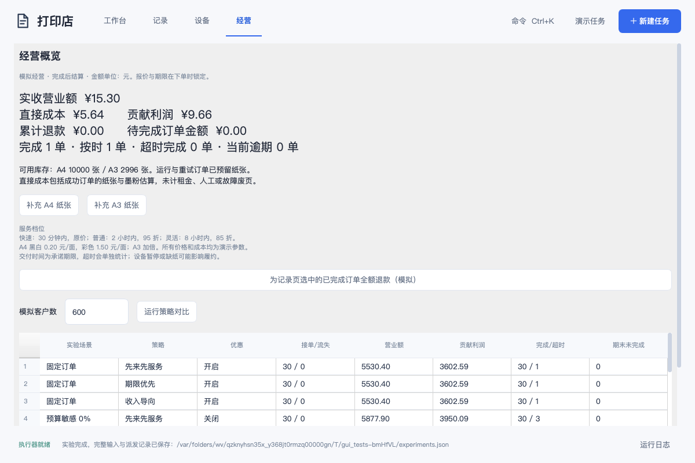
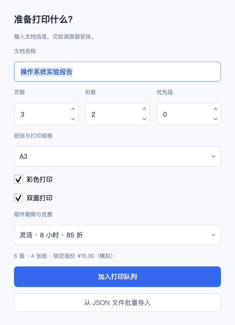

# 经营调度实验结果

本次结果来自 2026-09-23 本地实际运行：固定种子 `20260923`，600 名潜在客户，6 台异构设备，8 小时营业窗口。所有需求、预算、价格与成本均为模拟假设。

命令：`./build/dev/bin/shop-experiments --customers 600 --seed 20260923 --hours 8 --output runtime/shop-evidence/experiments.json`。摘要保存在 [shop-summary.json](../experiments/shop-summary.json)，完整原始报表可用该命令重建。

## 固定订单：隔离调度影响

| 策略 | 完成订单 | 营业额（元） | 贡献利润（元） | 超时完成 |
| --- | ---: | ---: | ---: | ---: |
| 先来先服务 | 285 | 39422.38 | 25713.58 | 168 |
| 交付期限优先 | 309 | 39268.51 | 26131.74 | 280 |
| 营业收入导向 | 279 | 41232.57 | 27159.97 | 176 |

这组负载中，收入策略营业额比 FCFS 高 4.59%，但完成单数从 285 降至 279，超时完成从 168 增至 176。它优先占用了收入较高的订单；收入改善不代表完成量和交付质量同时改善。

## 相同潜在客户：比较优惠与选择

| 预算敏感比例 | 优惠 | 策略 | 接单 / 流失 | 营业额（元） | 完成 / 超时 | 期末未完成 |
| --- | --- | --- | ---: | ---: | ---: | ---: |
| 0% | 无 | 先来先服务 | 600 / 0 | 42003.60 | 285 / 253 | 315 |
| 0% | 无 | 交付期限优先 | 600 / 0 | 42003.60 | 285 / 253 | 315 |
| 0% | 无 | 营业收入导向 | 600 / 0 | 42875.00 | 277 / 244 | 323 |
| 0% | 有 | 先来先服务 | 600 / 0 | 38854.03 | 285 / 148 | 315 |
| 0% | 有 | 交付期限优先 | 600 / 0 | 35793.24 | 319 / 232 | 281 |
| 0% | 有 | 营业收入导向 | 600 / 0 | 41384.49 | 285 / 158 | 315 |
| 30% | 无 | 先来先服务 | 438 / 162 | 40341.00 | 302 / 267 | 136 |
| 30% | 无 | 交付期限优先 | 438 / 162 | 40341.00 | 302 / 267 | 136 |
| 30% | 无 | 营业收入导向 | 438 / 162 | 43643.10 | 296 / 260 | 142 |
| 30% | 有 | 先来先服务 | 487 / 113 | 38729.57 | 289 / 129 | 198 |
| 30% | 有 | 交付期限优先 | 487 / 113 | 36338.62 | 321 / 150 | 166 |
| 30% | 有 | 营业收入导向 | 487 / 113 | 40433.07 | 291 / 137 | 196 |
| 60% | 无 | 先来先服务 | 254 / 346 | 29630.60 | 230 / 151 | 24 |
| 60% | 无 | 交付期限优先 | 254 / 346 | 29630.60 | 230 / 151 | 24 |
| 60% | 无 | 营业收入导向 | 254 / 346 | 31449.80 | 219 / 145 | 35 |
| 60% | 有 | 先来先服务 | 378 / 222 | 36768.66 | 305 / 97 | 73 |
| 60% | 有 | 交付期限优先 | 378 / 222 | 37617.40 | 311 / 16 | 67 |
| 60% | 有 | 营业收入导向 | 378 / 222 | 39095.48 | 299 / 90 | 79 |

预算敏感比例为 0% 时，优惠没有增加接单，收入下降。60% 时，优惠使部分能等待的客户愿意下单，三种策略的收入均有所增加。30% 场景中新增接单仍不足以保证更高收入。

这些是指定需求与行为模型下的结果，不是真实顾客调查，也不能证明某个策略在所有负载下最好。客户模型、成本边界、期末收入定义见 [经营说明](shop.md)。期限策略在过载下也可能大量超时；系统尚未实现根据未来产能承诺预约。

## 验证记录

- macOS arm64 / Qt 6.10.2：Debug 与 Release 的完整 CTest 测试通过（12 个测试入口，含更多内部场景）。
- 经营 GUI 实测：A3 彩色双面 3 页 × 2 份，灵活档报价 15.30 元，实际用纸 4 张，成本 5.64 元，完成后正确显示营业数据。
- 界面中的 21 组结果可导出；自动复核固定种子一致性、策略间输入不变、设备兼容与不重叠、闭店时点、收入与成本重算。
- 本地截图来自 Qt offscreen 运行；其他平台以该提交的 CI 结果为准。

